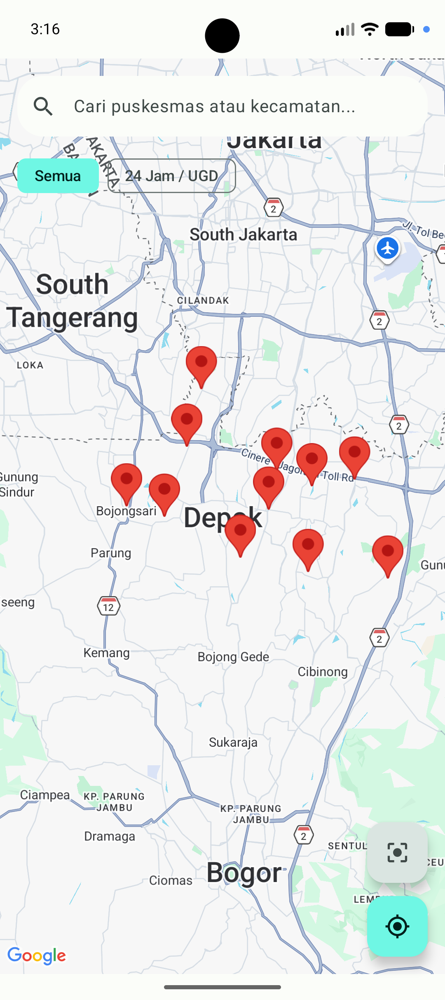
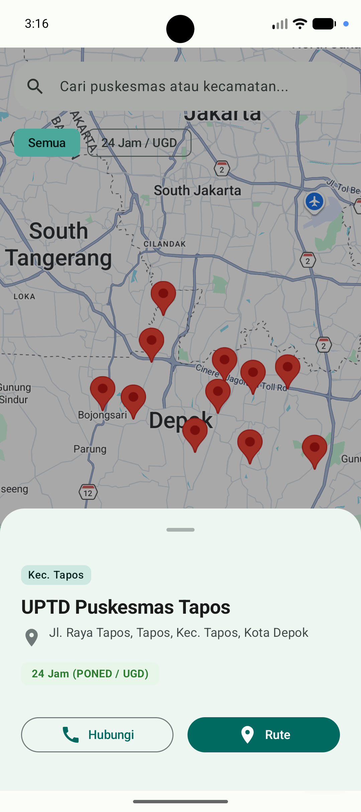

# LocPuskesmas (Android Portfolio Project)

Aplikasi **LocPuskesmas** adalah aplikasi pencari lokasi Pusat Kesehatan Masyarakat (Puskesmas) khusus di Kota Depok, Jawa Barat. Aplikasi ini dibangun untuk mendemonstrasikan implementasi praktik terbaik modern Android (Modern Android Development / MAD).

Aplikasi terhubung dengan endpoint JSON di GitHub Gist dan mampu berjalan *offline* berkat arsitektur data caching dengan **Room Database**. Desain antarmuka merujuk pada standar *Google Stitch Material 3 (Emerald Medical Theme)*.

## 📸 Tangkapan Layar (Screenshots)

<p align="center">
  
  &nbsp;&nbsp;&nbsp;&nbsp;
  
</p>

## 📱 Fitur Utama
1. **Interactive Google Maps**: Menggunakan `maps-compose` untuk performa peta deklaratif di atas Jetpack Compose.
2. **Offline-First Support (Single Source of Truth)**: Data di-*fetch* dari API menggunakan Retrofit, disimpan ke dalam database Room. UI selalu melakukan *observe* dari Room, bukan langsung dari API. Jika tidak ada sinyal (Offline), data di peta tetap muncul.
3. **Pencarian Cepat**: Filter berdasarkan Nama Puskesmas atau Kecamatan.
4. **Filter 24 Jam / UGD**: Filter instan untuk memisahkan puskesmas layanan normal dan IGD.
5. **Aksi Rute & Telepon**: Integrasi Intents bawaan Android.

## 🛠️ Tech Stack & Architecture
- **Language**: Kotlin 100%
- **Architecture**: Clean Architecture (Core, Data, Domain, Presentation) & MVVM.
- **UI Toolkit**: Jetpack Compose (Material Design 3).
- **Concurrency**: Kotlin Coroutines & Flow (StateFlow untuk *State Hoisting* di Compose).
- **Dependency Injection**: Dagger Hilt.
- **Networking**: Retrofit 2, OkHttp3.
- **Local Database**: Room Database.
- **Location Services**: Google Maps Compose, Google Play Services Location.

## 💡 Peralihan Konsep (Bagi Engineer dengan Background XML/Java)
Kode di dalam repositori ini dirancang khusus dengan tambahan komentar edukasional. Beberapa pemetaan (mapping) yang dapat dijumpai:
- `FrameLayout` -> `Box`
- `LinearLayout (Vertical)` -> `Column`
- `LinearLayout (Horizontal)` -> `Row`
- `RecyclerView` -> `LazyColumn` / `LazyRow`
- `BottomSheetBehavior` -> `ModalBottomSheet` + `rememberModalBottomSheetState()`
- **Update View (findViewById + setText)** -> **Recomposition**: UI otomatis di-gambar ulang oleh Compose setiap kali nilai variable (state) berubah, berkat konsep `collectAsStateWithLifecycle()`.

## 📦 Setup & Instalasi
1. Clone repositori ini.
2. Buka project di **Android Studio**.
3. Tambahkan file `secrets.properties` di root folder dan isi dengan Google Maps API Key Anda:
   ```properties
   MAPS_API_KEY=AIzaSy_MASUKKAN_KEY_ANDA_DISINI
   ```
4. Build dan Run di Emulator atau Physical Device.

## 🎨 Theme & Desain
Tema warna **Emerald Medical**:
- Primary: `#006A60`
- Primary Container: `#6FF7E4`
- Surface/Background: `#FBFDF9`

## 👨‍💻 Kontributor / Penulis
- **Package**: `com.rizqinh.locpuskesmas`
- **Domain API**: Gist GitHub
